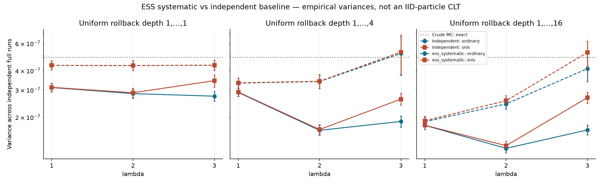
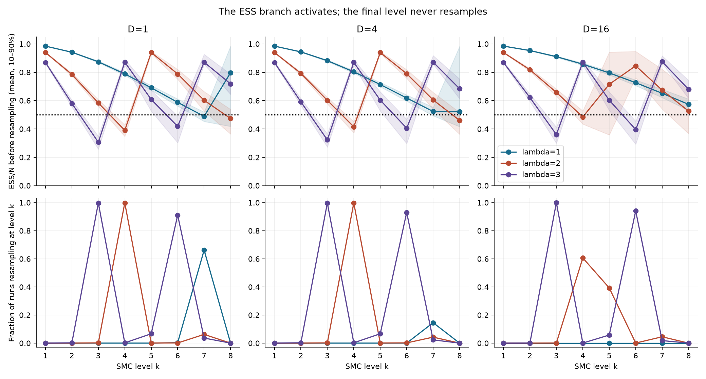
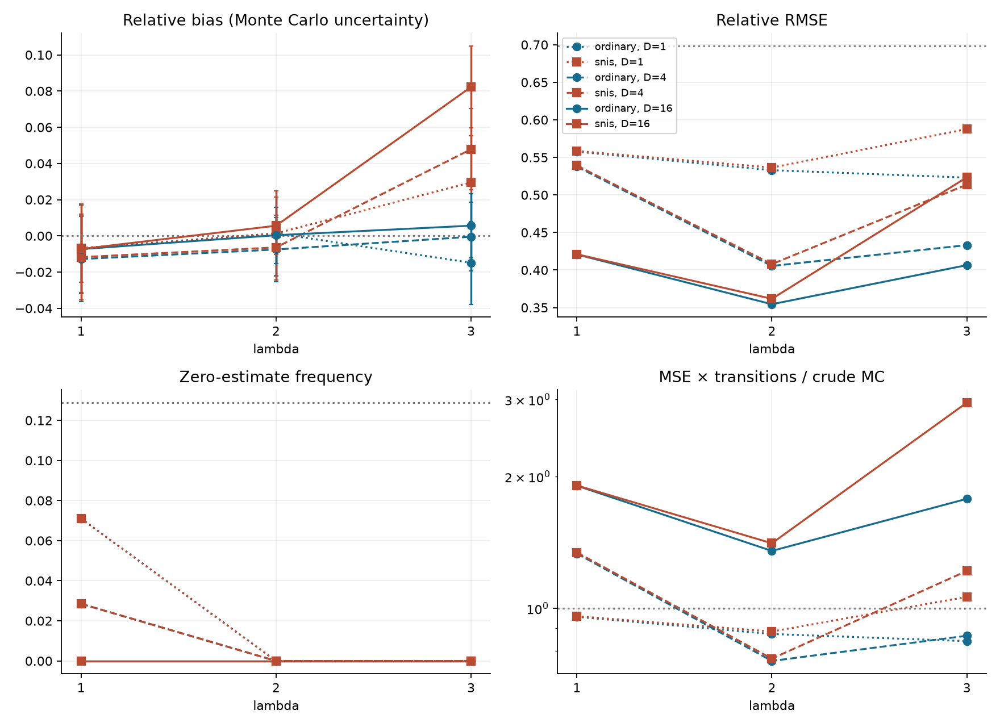

# Risultati: RollBack SMC con resampling ESS/systematic

N=2048; 2000 run indipendenti dell'intero algoritmo per configurazione; seed principale 20260929. T=16, R=8, una mutazione per livello; lambda=1,2,3; profondità uniforme 1,...,D, D=1,4,16. Controllo lambda=0. Baseline senza resampling ricalcolata con gli stessi seed originali, senza modificare i file precedenti.

Politica: systematic con un offset uniforme, ordine input conservato, ESS/N < 0.5, pesatura -> eventuale resampling -> mutazione a beta_k. Nessun resampling finale. Z_hat accumula tutti gli incrementi, anche senza resampling.

Resampling realmente attivo in 13621 run. Durata simulazioni e salvataggio: 243.70 s. I tempi includono anche la diagnostica. Le due stime di una popolazione condividono il costo; i loro tempi non vanno sommati.

## Teoria e limiti

L'ordinario è non distorto a N finito per la politica implementata, per unbiasedness condizionata dei conteggi systematic. E[Z_hat]=Z ed E[reverse_mass]=1. SNIS è un rapporto e può essere distorto. La derivazione include una decomposizione martingala esatta della varianza con covarianze systematic; non attribuisce a questa politica la CLT IID della baseline né una CLT multinomiale. La CLT tra run complete, a N fissato, riguarda invece la media delle run con centro nella sua aspettativa.

## Confronto nella configurazione con RMSE minimo osservato

Minimo descrittivo della griglia con resampling: lambda=2, D=16, ordinary. Non è una prova di ottimalità né una selezione indipendente dei parametri.

| lambda | D | policy | estimator | bias | bias_mc_se | variance | rmse | zero_frequency |
| --- | --- | --- | --- | --- | --- | --- | --- | --- |
| 0 | 0 | crude | ordinary | 1.75781e-05 | 1.56439e-05 | 4.89466e-07 | 0.000699665 | 0.128 |
| 2 | 16 | ess_systematic | ordinary | 3.68373e-07 | 7.928e-06 | 1.25706e-07 | 0.000354462 | 0 |
| 2 | 16 | ess_systematic | snis | 5.61376e-06 | 8.0883e-06 | 1.30841e-07 | 0.000361673 | 0 |
| 2 | 16 | independent | ordinary | 1.01195e-05 | 1.10395e-05 | 2.43743e-07 | 0.000493683 | 0 |
| 2 | 16 | independent | snis | 1.96248e-05 | 1.13088e-05 | 2.5578e-07 | 0.000506001 | 0 |

Per questo stimatore, MSE × costo in transizioni / crude MC teorico = 1.352. Un valore >1 significa che il guadagno per particella non compensa il costo. Non è una simulazione a budget abbinato.

## Tutte le configurazioni: accuratezza

| lambda | D | policy | estimator | bias | bias_mc_se | variance | rmse | zero_frequency |
| --- | --- | --- | --- | --- | --- | --- | --- | --- |
| 0 | 0 | crude | ordinary | 1.75781e-05 | 1.56439e-05 | 4.89466e-07 | 0.000699665 | 0.128 |
| 0 | 16 | ess_systematic | ordinary | -1.70898e-06 | 1.5178e-05 | 4.60741e-07 | 0.000678611 | 0.1185 |
| 0 | 16 | ess_systematic | snis | -1.70898e-06 | 1.5178e-05 | 4.60741e-07 | 0.000678611 | 0.1185 |
| 0 | 16 | independent | ordinary | -8.30078e-06 | 1.48222e-05 | 4.39396e-07 | 0.000662756 | 0.1155 |
| 0 | 16 | independent | snis | -8.30078e-06 | 1.48222e-05 | 4.39396e-07 | 0.000662756 | 0.1155 |
| 1 | 1 | ess_systematic | ordinary | -7.34615e-06 | 1.24709e-05 | 3.11045e-07 | 0.000557623 | 0.071 |
| 1 | 1 | ess_systematic | snis | -6.72804e-06 | 1.24908e-05 | 3.12041e-07 | 0.000558507 | 0.071 |
| 1 | 1 | independent | ordinary | 8.36183e-06 | 1.4711e-05 | 4.32826e-07 | 0.000657783 | 0.0825 |
| 1 | 1 | independent | snis | 8.46214e-06 | 1.47156e-05 | 4.33095e-07 | 0.000657989 | 0.0825 |
| 2 | 1 | ess_systematic | ordinary | 1.39597e-06 | 1.19207e-05 | 2.84205e-07 | 0.000532977 | 0 |
| 2 | 1 | ess_systematic | snis | 1.37051e-06 | 1.19979e-05 | 2.87897e-07 | 0.000536428 | 0 |
| 2 | 1 | independent | ordinary | -1.15129e-05 | 1.46888e-05 | 4.31521e-07 | 0.000656839 | 0.0605 |
| 2 | 1 | independent | snis | -1.11606e-05 | 1.46932e-05 | 4.31781e-07 | 0.000657031 | 0.0605 |
| 3 | 1 | ess_systematic | ordinary | -1.48336e-05 | 1.16938e-05 | 2.73491e-07 | 0.000523043 | 0 |
| 3 | 1 | ess_systematic | snis | 2.95513e-05 | 1.31269e-05 | 3.4463e-07 | 0.000587649 | 0 |
| 3 | 1 | independent | ordinary | -6.17655e-06 | 1.47272e-05 | 4.3378e-07 | 0.000658484 | 0.036 |
| 3 | 1 | independent | snis | -5.90786e-06 | 1.47337e-05 | 4.34162e-07 | 0.000658771 | 0.036 |
| 1 | 4 | ess_systematic | ordinary | -1.27777e-05 | 1.20248e-05 | 2.89191e-07 | 0.000537783 | 0.0285 |
| 1 | 4 | ess_systematic | snis | -1.17434e-05 | 1.20578e-05 | 2.90781e-07 | 0.000539234 | 0.0285 |
| 1 | 4 | independent | ordinary | -4.81174e-06 | 1.28895e-05 | 3.32279e-07 | 0.000576312 | 0.0295 |
| 1 | 4 | independent | snis | -4.32244e-06 | 1.29165e-05 | 3.33673e-07 | 0.000577516 | 0.0295 |
| 2 | 4 | ess_systematic | ordinary | -7.5199e-06 | 9.0664e-06 | 1.64399e-07 | 0.00040543 | 0 |
| 2 | 4 | ess_systematic | snis | -6.35172e-06 | 9.12152e-06 | 1.66404e-07 | 0.000407874 | 0 |
| 2 | 4 | independent | ordinary | 1.64704e-06 | 1.30433e-05 | 3.40257e-07 | 0.000583172 | 0.007 |
| 2 | 4 | independent | snis | 2.4928e-06 | 1.30696e-05 | 3.41631e-07 | 0.000584352 | 0.007 |
| 3 | 4 | ess_systematic | ordinary | -4.77066e-07 | 9.68814e-06 | 1.8772e-07 | 0.000433159 | 0 |
| 3 | 4 | ess_systematic | snis | 4.78389e-05 | 1.14401e-05 | 2.61751e-07 | 0.000513721 | 0 |
| 3 | 4 | independent | ordinary | -9.21488e-06 | 1.60807e-05 | 5.17179e-07 | 0.000719031 | 0.0015 |
| 3 | 4 | independent | snis | -5.24293e-06 | 1.62486e-05 | 5.28033e-07 | 0.000726496 | 0.0015 |
| 1 | 16 | ess_systematic | ordinary | -7.28998e-06 | 9.40897e-06 | 1.77057e-07 | 0.00042074 | 0 |
| 1 | 16 | ess_systematic | snis | -7.24221e-06 | 9.41545e-06 | 1.77301e-07 | 0.000421029 | 0 |
| 1 | 16 | independent | ordinary | -1.10789e-06 | 9.66963e-06 | 1.87003e-07 | 0.000432332 | 0 |
| 1 | 16 | independent | snis | 5.78814e-07 | 9.73528e-06 | 1.89551e-07 | 0.000435267 | 0 |
| 2 | 16 | ess_systematic | ordinary | 3.68373e-07 | 7.928e-06 | 1.25706e-07 | 0.000354462 | 0 |
| 2 | 16 | ess_systematic | snis | 5.61376e-06 | 8.0883e-06 | 1.30841e-07 | 0.000361673 | 0 |
| 2 | 16 | independent | ordinary | 1.01195e-05 | 1.10395e-05 | 2.43743e-07 | 0.000493683 | 0 |
| 2 | 16 | independent | snis | 1.96248e-05 | 1.13088e-05 | 2.5578e-07 | 0.000506001 | 0 |
| 3 | 16 | ess_systematic | ordinary | 5.63543e-06 | 9.09142e-06 | 1.65308e-07 | 0.000406518 | 0 |
| 3 | 16 | ess_systematic | snis | 8.22565e-05 | 1.1564e-05 | 2.67454e-07 | 0.000523533 | 0 |
| 3 | 16 | independent | ordinary | -6.96095e-06 | 1.43611e-05 | 4.1248e-07 | 0.000642123 | 0 |
| 3 | 16 | independent | snis | 4.26909e-05 | 1.61928e-05 | 5.24416e-07 | 0.000725242 | 0 |

Bias e varianze sono stimati da run intere indipendenti. SE(bias) è l'incertezza della media delle run, non della singola popolazione. I dati originali conservano seed, ESS per livello, resampling, log-incrementi, Z_hat e transizioni. Zero stime nulle osservate non significa probabilità di zero esattamente nulla.

## Costo e attivazione

| lambda | D | policy | median_seconds | mean_transitions | resampling_run_fraction | mean_resampling_count |
| --- | --- | --- | --- | --- | --- | --- |
| 0 | 0 | crude | 0.00032735 | 32768 | 0 | 0 |
| 0 | 16 | ess_systematic | 0.0070829 | 172046 | 0 | 0 |
| 0 | 16 | independent | 0.00611205 | 172029 | 0 | 0 |
| 1 | 1 | ess_systematic | 0.00427905 | 49152 | 0.665 | 0.665 |
| 1 | 1 | independent | 0.00329735 | 49152 | 0 | 0 |
| 2 | 1 | ess_systematic | 0.0043027 | 49152 | 1 | 1.0635 |
| 2 | 1 | independent | 0.0033037 | 49152 | 0 | 0 |
| 3 | 1 | ess_systematic | 0.00432895 | 49152 | 1 | 2.016 |
| 3 | 1 | independent | 0.0033022 | 49152 | 0 | 0 |
| 1 | 4 | ess_systematic | 0.0051892 | 73726.7 | 0.1455 | 0.1455 |
| 1 | 4 | independent | 0.0041582 | 73732 | 0 | 0 |
| 2 | 4 | ess_systematic | 0.00520125 | 73725.9 | 1 | 1.044 |
| 2 | 4 | independent | 0.00432825 | 73730.8 | 0 | 0 |
| 3 | 4 | ess_systematic | 0.00518885 | 73725.8 | 1 | 2.0225 |
| 3 | 4 | independent | 0.0041628 | 73728 | 0 | 0 |
| 1 | 16 | ess_systematic | 0.00762895 | 172049 | 0 | 0 |
| 1 | 16 | independent | 0.00658145 | 172045 | 0 | 0 |
| 2 | 16 | ess_systematic | 0.00764315 | 172024 | 1 | 1.0455 |
| 2 | 16 | independent | 0.006641 | 172034 | 0 | 0 |
| 3 | 16 | ess_systematic | 0.00765215 | 172026 | 1 | 2.017 |
| 3 | 16 | independent | 0.0065544 | 172012 | 0 | 0 |

## Normalizzatori e identità della popolazione

| lambda | D | mean_z_hat | z_hat_mc_se | true_z | mean_reverse_mass | reverse_mass_mc_se |
| --- | --- | --- | --- | --- | --- | --- |
| 0 | 16 | 1 | 0 | 1 | 1 | 0 |
| 1 | 1 | 1.64782 | 0.000998811 | 1.64872 | 0.999813 | 0.000331325 |
| 2 | 1 | 7.39178 | 0.0243208 | 7.38906 | 1.00184 | 0.00103254 |
| 3 | 1 | 88.3766 | 2.088 | 90.0171 | 0.994455 | 0.00506674 |
| 1 | 4 | 1.64824 | 0.000929612 | 1.64872 | 0.999655 | 0.000294275 |
| 2 | 4 | 7.38803 | 0.0202132 | 7.38906 | 1.00043 | 0.000972154 |
| 3 | 4 | 90.8203 | 1.66688 | 90.0171 | 1.0037 | 0.00641423 |
| 1 | 16 | 1.64785 | 0.000708352 | 1.64872 | 1.00038 | 0.000545134 |
| 2 | 16 | 7.39112 | 0.0178113 | 7.38906 | 0.999212 | 0.001704 |
| 3 | 16 | 88.989 | 1.26696 | 90.0171 | 0.996935 | 0.0076424 |

Le medie vanno confrontate con i loro errori Monte Carlo; non si pretende uguaglianza numerica esatta a campione finito. Nel CSV `whole_run_linearization_variance` è Var(U_N-p V_N) tra run: diagnostica di primo ordine del rapporto, non varianza CLT teorica dell'SMC e non predizione indipendente.

## Grafici

