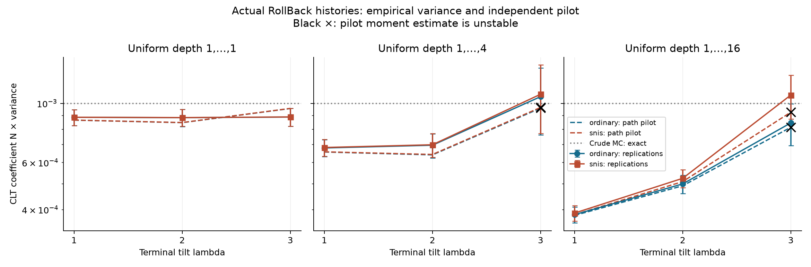
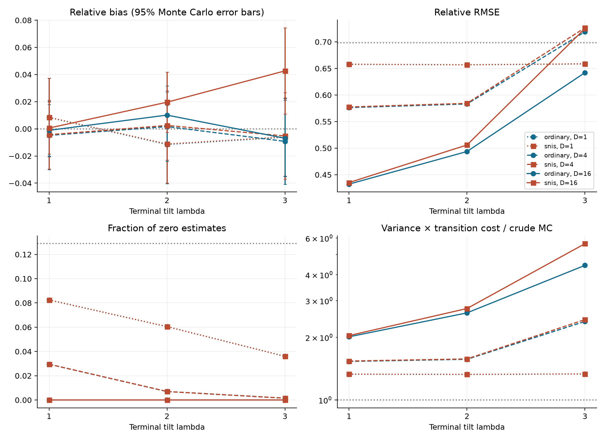
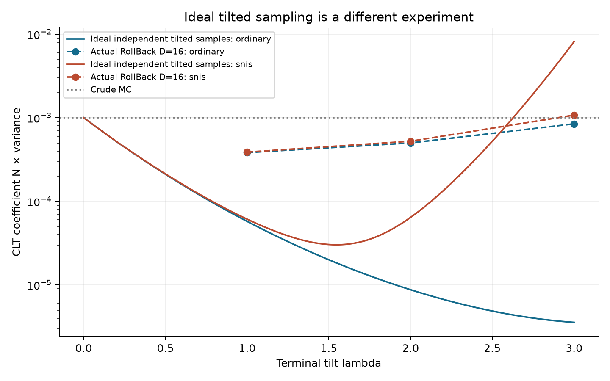

# Risultati: RollBack SMC gaussiano senza resampling

## Disegno riproducibile

Probabilità esatta p=0.001; soglia a=3.090232306168. T=16 transizioni originali N(x_t,1/T), R=8 livelli lineari, una mutazione MH per livello. N=2048 particelle per replica, 2000 repliche indipendenti per configurazione. Lambda=1,2,3; d uniforme in {1,...,D}, D=1,4,16. Controllo aggiuntivo lambda=0,D=16. Nessun resampling.

Per ogni configurazione, pilot indipendente di 2,097,152 storie, in 128 blocchi. Seed principale 20260929; i seed completi di ogni replica/blocco sono nei CSV. Le due stime SMC condividono il medesimo campione entro la replica: il loro confronto è appaiato. Le righe non costituiscono test multipli corretti e la selezione del minimo RMSE è descrittiva.

Durata della pipeline sperimentale: 104.64 secondi, inclusi pilot, salvataggi e grafici, esclusi test e scrittura della derivazione. Python 3.14.2, NumPy 2.5.1, SciPy 1.18.0. Versioni complete e piattaforma in `results/manifest.json`.

## Risultati teorici, separati dalle osservazioni

- Con W prodotto dei potenziali prima delle mutazioni, C=W exp(-lambda x_finale), U=C h e V=C, valgono E(U)=p ed E(V)=1 sotto la vera legge forward delle storie.
- IS ordinario è la media di U: non distorto per ogni N, varianza esatta Var(U)/N.
- SNIS è media(U)/media(V): consistente, generalmente distorto a N finito; coefficiente CLT E[(U-pV)^2]. Il suo rapporto di varianze col pilot è un confronto asintotico.
- Crude MC ha coefficiente CLT p(1-p)=0.000999, varianza della stima 4.87792969e-07, RMSE teorico 0.00069842177, probabilità di stima nulla 12.8861%.
- I coefficienti ideali sotto pi_lambda non valgono per il sampler RollBack. Tutti i passaggi sono in `DERIVAZIONE.md`.

## Accuratezza osservata a pari numero di particelle

Bias = media delle repliche meno p. SE(bias) misura l'incertezza Monte Carlo nella stima del bias; non è l'errore standard di una singola stima. Varianza campionaria con denominatore B-1; RMSE rispetto al p esatto. Le unità delle colonne sono esplicite.

| lambda | D | Metodo | Bias / 1e-5 | SE(bias) / 1e-5 | Varianza / 1e-7 | RMSE / 1e-4 | Zeri % |
|---:|---:|:---|---:|---:|---:|---:|---:|
| 0 | 0 | crude | 1.758 | 1.564 | 4.8947 | 6.9966 | 12.80 |
| 0 | 16 | ordinary | -0.830 | 1.482 | 4.3940 | 6.6276 | 11.55 |
| 0 | 16 | snis | -0.830 | 1.482 | 4.3940 | 6.6276 | 11.55 |
| 1 | 1 | ordinary | 0.836 | 1.471 | 4.3283 | 6.5778 | 8.25 |
| 1 | 1 | snis | 0.846 | 1.472 | 4.3310 | 6.5799 | 8.25 |
| 2 | 1 | ordinary | -1.151 | 1.469 | 4.3152 | 6.5684 | 6.05 |
| 2 | 1 | snis | -1.116 | 1.469 | 4.3178 | 6.5703 | 6.05 |
| 3 | 1 | ordinary | -0.618 | 1.473 | 4.3378 | 6.5848 | 3.60 |
| 3 | 1 | snis | -0.591 | 1.473 | 4.3416 | 6.5877 | 3.60 |
| 1 | 4 | ordinary | -0.481 | 1.289 | 3.3228 | 5.7631 | 2.95 |
| 1 | 4 | snis | -0.432 | 1.292 | 3.3367 | 5.7752 | 2.95 |
| 2 | 4 | ordinary | 0.165 | 1.304 | 3.4026 | 5.8317 | 0.70 |
| 2 | 4 | snis | 0.249 | 1.307 | 3.4163 | 5.8435 | 0.70 |
| 3 | 4 | ordinary | -0.921 | 1.608 | 5.1718 | 7.1903 | 0.15 |
| 3 | 4 | snis | -0.524 | 1.625 | 5.2803 | 7.2650 | 0.15 |
| 1 | 16 | ordinary | -0.111 | 0.967 | 1.8700 | 4.3233 | 0.00 |
| 1 | 16 | snis | 0.058 | 0.974 | 1.8955 | 4.3527 | 0.00 |
| 2 | 16 | ordinary | 1.012 | 1.104 | 2.4374 | 4.9368 | 0.00 |
| 2 | 16 | snis | 1.962 | 1.131 | 2.5578 | 5.0600 | 0.00 |
| 3 | 16 | ordinary | -0.696 | 1.436 | 4.1248 | 6.4212 | 0.00 |
| 3 | 16 | snis | 4.269 | 1.619 | 5.2442 | 7.2524 | 0.00 |

## Costo osservato

Una transizione conta una nuova innovazione gaussiana del decoder, anche nelle proposal rifiutate. Costo esatto NT+somma(d) per replica SMC. Il tempo mediano include entrambi gli stimatori; non va sommato due volte. Il pilot ha un costo aggiuntivo distinto. I tempi sono specifici di questa esecuzione.

| lambda | D | Transizioni medie / replica | Costo / crude MC | Tempo mediano (ms) | Accettazione % | Pilot (s) |
|---:|---:|---:|---:|---:|---:|---:|
| 0 | 0 | 32768.0 | 1.000 | 0.367 | 0.00 | 0.000 |
| 0 | 16 | 172029.4 | 5.250 | 4.711 | 100.00 | 4.976 |
| 1 | 1 | 49152.0 | 1.500 | 1.692 | 92.32 | 2.974 |
| 2 | 1 | 49152.0 | 1.500 | 1.672 | 85.32 | 2.565 |
| 3 | 1 | 49152.0 | 1.500 | 1.650 | 79.07 | 2.532 |
| 1 | 4 | 73732.0 | 2.250 | 2.452 | 88.76 | 3.103 |
| 2 | 4 | 73730.8 | 2.250 | 2.447 | 79.55 | 3.079 |
| 3 | 4 | 73728.0 | 2.250 | 2.428 | 72.26 | 3.004 |
| 1 | 16 | 172045.3 | 5.250 | 4.752 | 81.45 | 4.670 |
| 2 | 16 | 172034.3 | 5.250 | 4.736 | 69.33 | 4.574 |
| 3 | 16 | 172012.1 | 5.249 | 4.705 | 61.38 | 4.502 |

## Varianza empirica e predizione indipendente

Le predizioni utilizzano il pilot delle vere storie RollBack. Per crude MC e lambda=0 è utilizzato il valore analitico esatto. Le colonne riportano coefficienti N Var(stima), non varianze delle stime. SE pilot è l'errore standard Monte Carlo del coefficiente stimato. Il rapporto è varianza empirica / (coefficiente predetto/N).

| lambda | D | Metodo | N Var empirica / 1e-3 | Coeff. predetto / 1e-3 | SE pilot / 1e-3 | Rapporto | Pilot stabile |
|---:|---:|:---|---:|---:|---:|---:|:---|
| 0 | 0 | crude | 1.0024 | 0.9990 | 0.0000 | 1.003 | sì |
| 0 | 16 | ordinary | 0.8999 | 0.9990 | 0.0000 | 0.901 | sì |
| 0 | 16 | snis | 0.8999 | 0.9990 | 0.0000 | 0.901 | sì |
| 1 | 1 | ordinary | 0.8864 | 0.8651 | 0.0194 | 1.025 | sì |
| 1 | 1 | snis | 0.8870 | 0.8654 | 0.0194 | 1.025 | sì |
| 2 | 1 | ordinary | 0.8838 | 0.8466 | 0.0248 | 1.044 | sì |
| 2 | 1 | snis | 0.8843 | 0.8472 | 0.0248 | 1.044 | sì |
| 3 | 1 | ordinary | 0.8884 | 0.9562 | 0.0413 | 0.929 | sì |
| 3 | 1 | snis | 0.8892 | 0.9571 | 0.0412 | 0.929 | sì |
| 1 | 4 | ordinary | 0.6805 | 0.6573 | 0.0150 | 1.035 | sì |
| 1 | 4 | snis | 0.6834 | 0.6583 | 0.0149 | 1.038 | sì |
| 2 | 4 | ordinary | 0.6968 | 0.6412 | 0.0242 | 1.087 | sì |
| 2 | 4 | snis | 0.6997 | 0.6434 | 0.0242 | 1.087 | sì |
| 3 | 4 | ordinary | 1.0592 | 0.9595 | 0.1143 | 1.104 | no |
| 3 | 4 | snis | 1.0814 | 0.9651 | 0.1141 | 1.120 | no |
| 1 | 16 | ordinary | 0.3830 | 0.3805 | 0.0091 | 1.007 | sì |
| 1 | 16 | snis | 0.3882 | 0.3830 | 0.0090 | 1.014 | sì |
| 2 | 16 | ordinary | 0.4992 | 0.4912 | 0.0157 | 1.016 | sì |
| 2 | 16 | snis | 0.5238 | 0.5091 | 0.0159 | 1.029 | sì |
| 3 | 16 | ordinary | 0.8448 | 0.8135 | 0.1718 | 1.038 | no |
| 3 | 16 | snis | 1.0740 | 0.9265 | 0.1723 | 1.159 | no |

La stabilità richiede SE relativo <15%, massimo contributo <2% del totale dei quadrati, e differenza relativa tra metà del pilot <40%. La diagnostica non certifica l'assenza di code non osservate. La quota dello 0.1% dei contributi maggiori è salvata in JSON; essendo l'evento raro, tale quota può essere alta anche per crude MC.

Configurazioni con pilot non stabile (lambda,D): (3, 4), (3, 16).

## Osservazioni sperimentali

1. Il minimo RMSE osservato nella griglia è ordinary, lambda=1, D=16: 0.000432332. Il suo rapporto di varianza con il crude MC teorico a pari N è 0.383. È un risultato per questa griglia, non una dimostrazione di ottimalità.
2. Il crude MC ha media osservata 0.00101758, bias stimato 1.76e-05 con SE 1.56e-05; questa fluttuazione non cambia la sua non distorsione teorica. Per i confronti principali il riferimento è p esatto e la varianza teorica, non il solo crude MC empirico.
3. Nelle configurazioni con pilot stabile, i rapporti varianza empirica/predetta vanno da 0.929 a 1.087. Vanno letti insieme agli errori Monte Carlo delle due stime, disponibili nei CSV. Non sono identità numeriche esatte.
4. Meno stime nulle non implica minore varianza: aumentare il tilt può migliorare la scoperta dell'evento e contemporaneamente concentrare i contributi corretti in poche storie. Per lambda=3 i momenti possono restare instabili anche con milioni di storie pilota; non attribuiamo automaticamente le discrepanze a un errore della CLT.
5. Per la configurazione con RMSE minimo, il rapporto varianza × transizioni rispetto a crude MC è 2.013. Un valore maggiore di 1 indica che il guadagno per particella non compensa il costo aggiuntivo in transizioni. Questo indicatore non è una replica a budget abbinato; per SNIS non incorpora il bias.
6. SNIS e IS ordinario hanno zeri simultanei perché il denominatore SNIS è positivo. La loro differenza di varianza e bias dipende dalla variabilità del denominatore e dalla sua covarianza con il numeratore; non si assume che SNIS migliori sempre IS ordinario.

Per lambda=3,D=16, il confronto appaiato SNIS meno ordinario dà una differenza media di 4.96518e-05, con errore Monte Carlo 4.82841e-06. Poiché l'ordinario è teoricamente non distorto, questa differenza stima il bias di SNIS con maggiore precisione della sola media SNIS meno p. È circa il 4.97% di p: evidenza di un effetto della normalizzazione a N finito in questa configurazione.

## Controllo aggiuntivo a tilt nullo

Il controllo principale a lambda=0 ha rapporto di varianza empirica/teorica 0.901, insolitamente basso; non è stato eliminato né sostituito. Per verificarlo abbiamo eseguito altre 4000 repliche indipendenti, N=2048, con seed principale 20260929 e stream 3, salvate separatamente.

Nel controllo aggiuntivo la varianza è 4.89741437e-07, contro 4.87792969e-07 teorica (rapporto 1.0040). La differenza è 0.160 errori standard della varianza campionaria, calcolati dal quarto momento binomiale esatto. La frequenza di zeri è 13.325%, contro 12.886% teorico. Questo controllo è compatibile con la legge prevista; la deviazione del primo controllo resta documentata. Costo aggiuntivo: 18.12 secondi.

## Verifiche

Otto test mirati superati: marginale originale; prefisso e profondità uniforme; cancellazione algebrica del rapporto MH; invarianza di media, varianza e covarianza della legge tilted completa; pesi prima della mutazione e prodotto degli incrementi di normalizzazione; limiti senza mutazione e a tilt nullo; identità FK e inverse sui momenti e sull'evento; equivalenza algebrica degli stimatori. I controlli statistici usano seed separati e tolleranze Monte Carlo esplicite. L'invarianza teorica è dimostrata, non dedotta soltanto dai test.

## Grafici

Le barre rappresentano circa 1.96 errori Monte Carlo della varianza o del bias stimati dalle repliche, e possono essere poco affidabili quando dominano le code. Le croci nere segnalano pilot instabili. Le curve ideali sono solo formule analitiche di un diverso esperimento.
