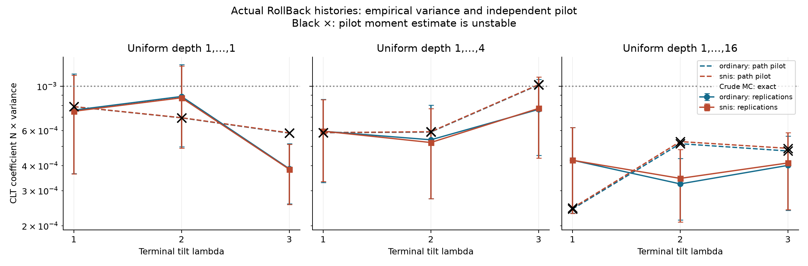
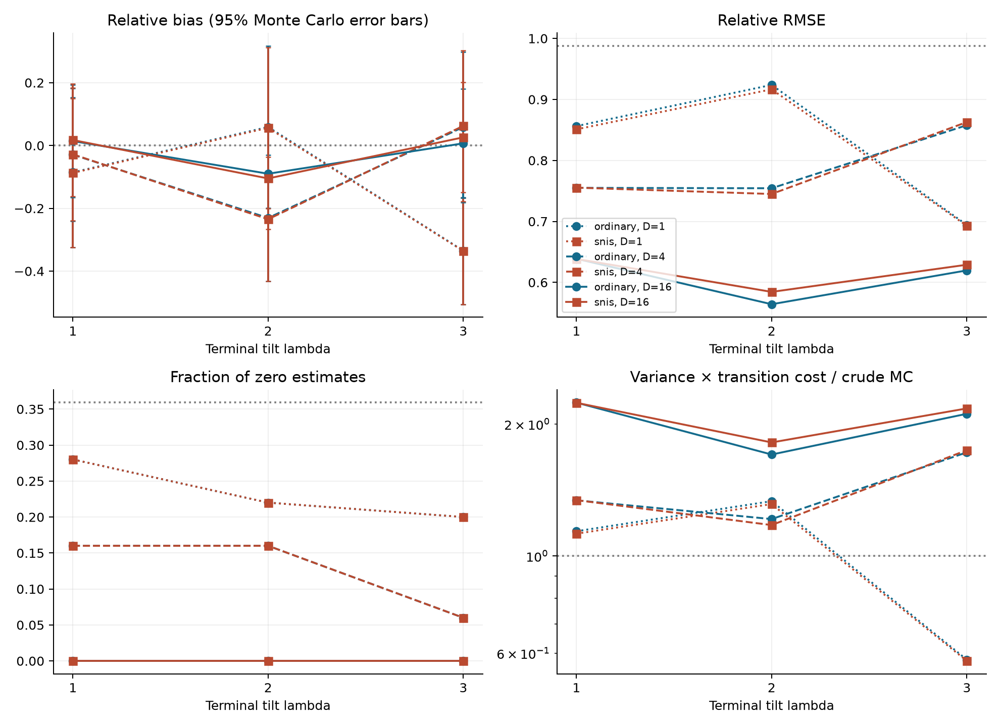
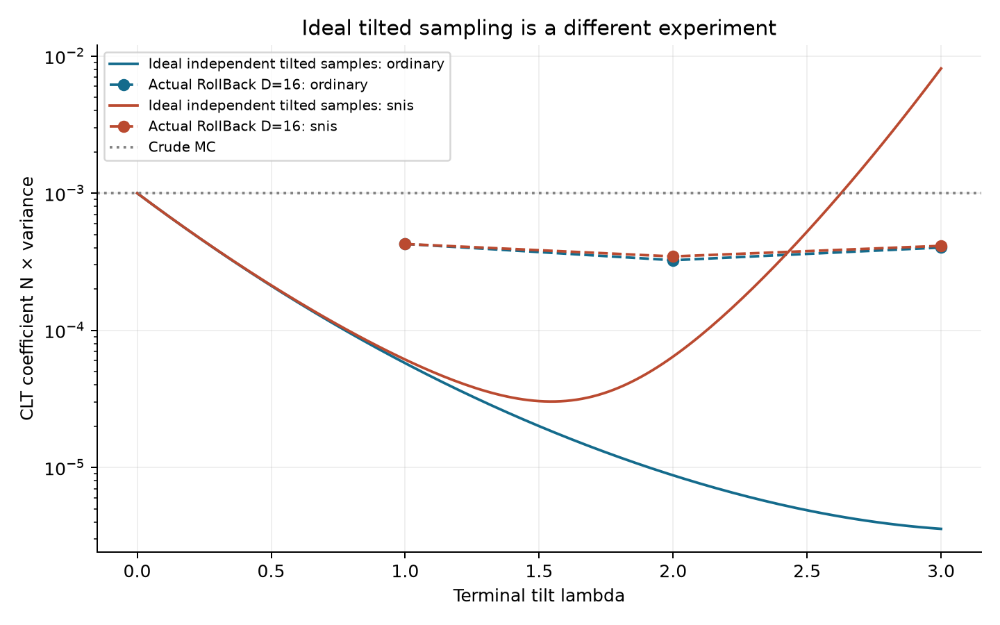

# Risultati: RollBack SMC gaussiano senza resampling

## Disegno riproducibile

Probabilità esatta p=0.001; soglia a=3.090232306168. T=16 transizioni originali N(x_t,1/T), R=8 livelli lineari, una mutazione MH per livello. N=1024 particelle per replica, 50 repliche indipendenti per configurazione. Lambda=1,2,3; d uniforme in {1,...,D}, D=1,4,16. Controllo aggiuntivo lambda=0,D=16. Nessun resampling.

Per ogni configurazione, pilot indipendente di 16,384 storie, in 4 blocchi. Seed principale 20260929; i seed completi di ogni replica/blocco sono nei CSV. Le due stime SMC condividono il medesimo campione entro la replica: il loro confronto è appaiato. Le righe non costituiscono test multipli corretti e la selezione del minimo RMSE è descrittiva.

Durata della pipeline sperimentale: 2.25 secondi, inclusi pilot, salvataggi e grafici, esclusi test e scrittura della derivazione. Python 3.14.2, NumPy 2.5.1, SciPy 1.18.0. Versioni complete e piattaforma in `results/manifest.json`.

## Risultati teorici, separati dalle osservazioni

- Con W prodotto dei potenziali prima delle mutazioni, C=W exp(-lambda x_finale), U=C h e V=C, valgono E(U)=p ed E(V)=1 sotto la vera legge forward delle storie.
- IS ordinario è la media di U: non distorto per ogni N, varianza esatta Var(U)/N.
- SNIS è media(U)/media(V): consistente, generalmente distorto a N finito; coefficiente CLT E[(U-pV)^2]. Il suo rapporto di varianze col pilot è un confronto asintotico.
- Crude MC ha coefficiente CLT p(1-p)=0.000999, varianza della stima 9.75585938e-07, RMSE teorico 0.000987717539, probabilità di stima nulla 35.8971%.
- I coefficienti ideali sotto pi_lambda non valgono per il sampler RollBack. Tutti i passaggi sono in `DERIVAZIONE.md`.

## Accuratezza osservata a pari numero di particelle

Bias = media delle repliche meno p. SE(bias) misura l'incertezza Monte Carlo nella stima del bias; non è l'errore standard di una singola stima. Varianza campionaria con denominatore B-1; RMSE rispetto al p esatto. Le unità delle colonne sono esplicite.

| lambda | D | Metodo | Bias / 1e-5 | SE(bias) / 1e-5 | Varianza / 1e-7 | RMSE / 1e-4 | Zeri % |
|---:|---:|:---|---:|---:|---:|---:|---:|
| 0 | 0 | crude | 3.516 | 13.500 | 9.1125 | 9.4565 | 28.00 |
| 0 | 16 | ordinary | -23.828 | 11.602 | 6.7302 | 8.4637 | 44.00 |
| 0 | 16 | snis | -23.828 | 11.602 | 6.7302 | 8.4637 | 44.00 |
| 1 | 1 | ordinary | -8.564 | 12.171 | 7.4062 | 8.5624 | 28.00 |
| 1 | 1 | snis | -8.720 | 12.093 | 7.3120 | 8.5099 | 28.00 |
| 2 | 1 | ordinary | 5.894 | 13.170 | 8.6729 | 9.2381 | 22.00 |
| 2 | 1 | snis | 5.630 | 13.070 | 8.5409 | 9.1661 | 22.00 |
| 3 | 1 | ordinary | -33.516 | 8.684 | 3.7710 | 6.9418 | 20.00 |
| 3 | 1 | snis | -33.576 | 8.657 | 3.7471 | 6.9279 | 20.00 |
| 1 | 4 | ordinary | -2.904 | 10.778 | 5.8078 | 7.5499 | 16.00 |
| 1 | 4 | snis | -2.807 | 10.783 | 5.8139 | 7.5535 | 16.00 |
| 2 | 4 | ordinary | -23.078 | 10.260 | 5.2635 | 7.5437 | 16.00 |
| 2 | 4 | snis | -23.477 | 10.100 | 5.1005 | 7.4496 | 16.00 |
| 3 | 4 | ordinary | 5.885 | 12.225 | 7.4722 | 8.5775 | 6.00 |
| 3 | 4 | snis | 6.240 | 12.295 | 7.5579 | 8.6288 | 6.00 |
| 1 | 16 | ordinary | 1.409 | 9.123 | 4.1612 | 6.3874 | 0.00 |
| 1 | 16 | snis | 1.740 | 9.119 | 4.1577 | 6.3856 | 0.00 |
| 2 | 16 | ordinary | -8.989 | 7.957 | 3.1658 | 5.6420 | 0.00 |
| 2 | 16 | snis | -10.489 | 8.214 | 3.3732 | 5.8444 | 0.00 |
| 3 | 16 | ordinary | 0.691 | 8.852 | 3.9178 | 6.1967 | 0.00 |
| 3 | 16 | snis | 2.601 | 8.978 | 4.0299 | 6.2898 | 0.00 |

## Costo osservato

Una transizione conta una nuova innovazione gaussiana del decoder, anche nelle proposal rifiutate. Costo esatto NT+somma(d) per replica SMC. Il tempo mediano include entrambi gli stimatori; non va sommato due volte. Il pilot ha un costo aggiuntivo distinto. I tempi sono specifici di questa esecuzione.

| lambda | D | Transizioni medie / replica | Costo / crude MC | Tempo mediano (ms) | Accettazione % | Pilot (s) |
|---:|---:|---:|---:|---:|---:|---:|
| 0 | 0 | 16384.0 | 1.000 | 0.189 | 0.00 | 0.000 |
| 0 | 16 | 85925.7 | 5.244 | 2.945 | 100.00 | 0.031 |
| 1 | 1 | 24576.0 | 1.500 | 0.985 | 92.41 | 0.019 |
| 2 | 1 | 24576.0 | 1.500 | 0.975 | 85.37 | 0.015 |
| 3 | 1 | 24576.0 | 1.500 | 0.965 | 79.00 | 0.014 |
| 1 | 4 | 36859.3 | 2.250 | 1.474 | 88.79 | 0.019 |
| 2 | 4 | 36858.8 | 2.250 | 1.406 | 79.51 | 0.018 |
| 3 | 4 | 36865.1 | 2.250 | 1.392 | 72.15 | 0.016 |
| 1 | 16 | 85958.2 | 5.246 | 2.883 | 81.32 | 0.031 |
| 2 | 16 | 86017.5 | 5.250 | 3.136 | 69.33 | 0.029 |
| 3 | 16 | 86090.0 | 5.255 | 3.163 | 61.21 | 0.032 |

## Varianza empirica e predizione indipendente

Le predizioni utilizzano il pilot delle vere storie RollBack. Per crude MC e lambda=0 è utilizzato il valore analitico esatto. Le colonne riportano coefficienti N Var(stima), non varianze delle stime. SE pilot è l'errore standard Monte Carlo del coefficiente stimato. Il rapporto è varianza empirica / (coefficiente predetto/N).

| lambda | D | Metodo | N Var empirica / 1e-3 | Coeff. predetto / 1e-3 | SE pilot / 1e-3 | Rapporto | Pilot stabile |
|---:|---:|:---|---:|---:|---:|---:|:---|
| 0 | 0 | crude | 0.9331 | 0.9990 | 0.0000 | 0.934 | sì |
| 0 | 16 | ordinary | 0.6892 | 0.9990 | 0.0000 | 0.690 | no |
| 0 | 16 | snis | 0.6892 | 0.9990 | 0.0000 | 0.690 | no |
| 1 | 1 | ordinary | 0.7584 | 0.7896 | 0.2226 | 0.960 | no |
| 1 | 1 | snis | 0.7487 | 0.7901 | 0.2222 | 0.948 | no |
| 2 | 1 | ordinary | 0.8881 | 0.6943 | 0.2044 | 1.279 | no |
| 2 | 1 | snis | 0.8746 | 0.6952 | 0.2040 | 1.258 | no |
| 3 | 1 | ordinary | 0.3862 | 0.5819 | 0.3385 | 0.664 | no |
| 3 | 1 | snis | 0.3837 | 0.5836 | 0.3378 | 0.657 | no |
| 1 | 4 | ordinary | 0.5947 | 0.5846 | 0.1172 | 1.017 | no |
| 1 | 4 | snis | 0.5953 | 0.5857 | 0.1169 | 1.017 | no |
| 2 | 4 | ordinary | 0.5390 | 0.5893 | 0.2441 | 0.915 | no |
| 2 | 4 | snis | 0.5223 | 0.5914 | 0.2436 | 0.883 | no |
| 3 | 4 | ordinary | 0.7652 | 1.0147 | 0.5470 | 0.754 | no |
| 3 | 4 | snis | 0.7739 | 1.0183 | 0.5459 | 0.760 | no |
| 1 | 16 | ordinary | 0.4261 | 0.2426 | 0.0514 | 1.756 | no |
| 1 | 16 | snis | 0.4257 | 0.2453 | 0.0513 | 1.735 | no |
| 2 | 16 | ordinary | 0.3242 | 0.5153 | 0.2619 | 0.629 | no |
| 2 | 16 | snis | 0.3454 | 0.5279 | 0.2614 | 0.654 | no |
| 3 | 16 | ordinary | 0.4012 | 0.4737 | 0.1168 | 0.847 | no |
| 3 | 16 | snis | 0.4127 | 0.4886 | 0.1166 | 0.845 | no |

La stabilità richiede SE relativo <15%, massimo contributo <2% del totale dei quadrati, e differenza relativa tra metà del pilot <40%. La diagnostica non certifica l'assenza di code non osservate. La quota dello 0.1% dei contributi maggiori è salvata in JSON; essendo l'evento raro, tale quota può essere alta anche per crude MC.

Configurazioni con pilot non stabile (lambda,D): (0, 16), (1, 1), (1, 4), (1, 16), (2, 1), (2, 4), (2, 16), (3, 1), (3, 4), (3, 16).

## Osservazioni sperimentali

1. Il minimo RMSE osservato nella griglia è ordinary, lambda=2, D=16: 0.000564202. Il suo rapporto di varianza con il crude MC teorico a pari N è 0.324. È un risultato per questa griglia, non una dimostrazione di ottimalità.
2. Il crude MC ha media osservata 0.00103516, bias stimato 3.52e-05 con SE 0.000135; questa fluttuazione non cambia la sua non distorsione teorica. Per i confronti principali il riferimento è p esatto e la varianza teorica, non il solo crude MC empirico.
3. Nessuna configurazione a tilt positivo supera i criteri di stabilità del pilot: questo budget non consente un confronto affidabile dei secondi momenti.
4. Meno stime nulle non implica minore varianza: aumentare il tilt può migliorare la scoperta dell'evento e contemporaneamente concentrare i contributi corretti in poche storie. Per lambda=3 i momenti possono restare instabili anche con milioni di storie pilota; non attribuiamo automaticamente le discrepanze a un errore della CLT.
5. Per la configurazione con RMSE minimo, il rapporto varianza × transizioni rispetto a crude MC è 1.704. Un valore maggiore di 1 indica che il guadagno per particella non compensa il costo aggiuntivo in transizioni. Questo indicatore non è una replica a budget abbinato; per SNIS non incorpora il bias.
6. SNIS e IS ordinario hanno zeri simultanei perché il denominatore SNIS è positivo. La loro differenza di varianza e bias dipende dalla variabilità del denominatore e dalla sua covarianza con il numeratore; non si assume che SNIS migliori sempre IS ordinario.

Per lambda=3,D=16, il confronto appaiato SNIS meno ordinario dà una differenza media di 1.91047e-05, con errore Monte Carlo 3.74144e-05. Poiché l'ordinario è teoricamente non distorto, questa differenza stima il bias di SNIS con maggiore precisione della sola media SNIS meno p. È circa il 1.91% di p: evidenza di un effetto della normalizzazione a N finito in questa configurazione.

## Verifiche

Otto test mirati superati: marginale originale; prefisso e profondità uniforme; cancellazione algebrica del rapporto MH; invarianza di media, varianza e covarianza della legge tilted completa; pesi prima della mutazione e prodotto degli incrementi di normalizzazione; limiti senza mutazione e a tilt nullo; identità FK e inverse sui momenti e sull'evento; equivalenza algebrica degli stimatori. I controlli statistici usano seed separati e tolleranze Monte Carlo esplicite. L'invarianza teorica è dimostrata, non dedotta soltanto dai test.

## Grafici

Le barre rappresentano circa 1.96 errori Monte Carlo della varianza o del bias stimati dalle repliche, e possono essere poco affidabili quando dominano le code. Le croci nere segnalano pilot instabili. Le curve ideali sono solo formule analitiche di un diverso esperimento.
